# EDA - data exploration (Person A)

Exploration of the 80 train and 10 test trips: what is in the files, how clean
they are, how noisy the GPS is, and what that means for candidate generation,
labelling and modelling.

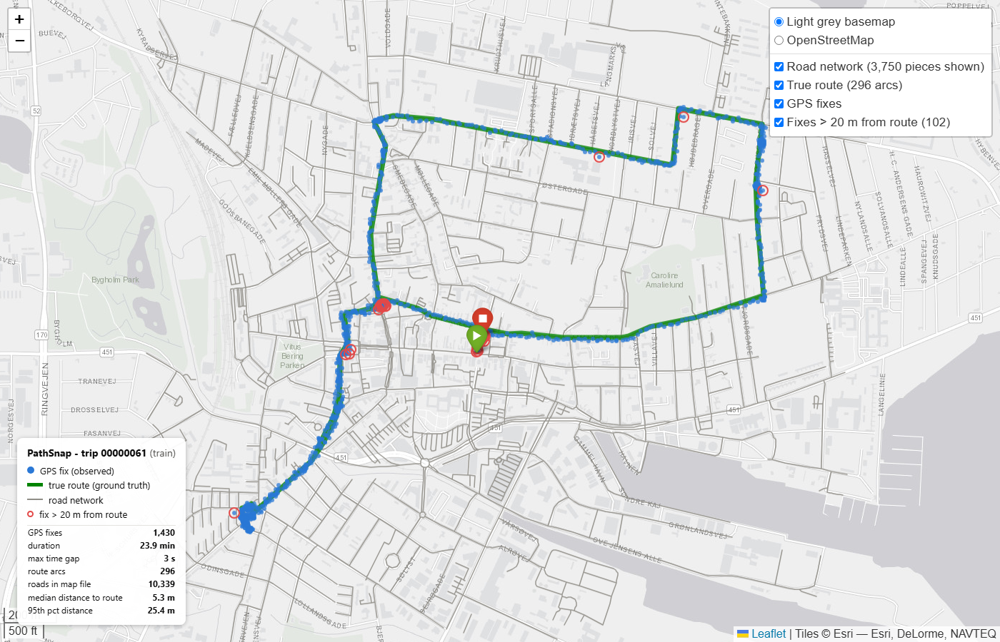

*Trip 00000061 (Horsens, Denmark): blue = GPS fixes, grey = road network,
green = true route, red rings = fixes more than 20 m from the true route.
Interactive version: [`results/eda/maps/trip_00000061.html`](../results/eda/maps/trip_00000061.html)
(download it and open it in a browser, because GitHub does not run the map).*

---

## How to run

```bash
pip install -r requirements.txt          # pandas, numpy, pyproj, shapely, folium, matplotlib
python -m eda.run_eda                    # everything, ~3 min -> results/eda/
python -m eda.trip_map 00000007          # interactive map for any trip
python -m eda.trip_map --all-test        # maps for all 10 test trips
```

Run the commands from the repo root. The dataset is **not** in git. Put it at `data/`
(or point `PATHSNAP_DATA` at another folder):

```
data/train/<trip_id>/<trip_id>.{track,nodes,arcs,route}          80 trips
data/student_test/<trip_id>/<trip_id>.{track,nodes,arcs,route}   10 trips
```

| File | Purpose |
|---|---|
| `loader.py` | `load_trip(id)` / `iter_trips()` → pandas tables with named columns. **Reusable by everyone.** |
| `geo.py` | haversine, per-trip UTM projection (`LocalProjection`), fast point-to-segment distance (STRtree) |
| `trip_summary.py` | per-trip statistics → `results/eda/trip_summary.csv/.md`, `split_summary.csv` |
| `plots.py` | the 10 static figures → `results/eda/figures/` |
| `trip_map.py` | Folium maps → `results/eda/maps/` |
| `run_eda.py` | runs all of the above |

## File format (checked on all 90 trips)

| File | Columns | Notes |
|---|---|---|
| `.track` | `lon lat time` | one GPS fix per line, time in seconds, strictly increasing |
| `.nodes` | `lon lat` | node id = 0-based line number |
| `.arcs` | `from_node to_node` | **directed** road piece, arc id = 0-based line number. A two-way street is 2 arcs |
| `.route` | `arc_id` | true route as arc ids **in driving order**; consecutive arcs share a node |

**Longitude comes first.** Some trips have a first column > 90 (trip 21 is at 106.7° E,
in Vietnam), so it cannot be latitude. `loader.py` names the columns, so you never index them by number.

---

## Key findings

### 1. Size: 90 trips, 227,577 GPS fixes, 4.06 M road arcs

| | train | test | all |
|---|---:|---:|---:|
| trips | 80 | 10 | 90 |
| GPS fixes | 208,417 | 19,160 | 227,577 |
| fixes per trip (median, min–max) | 1,529 (361–19,313) | 1,420 (262–3,958) | 1,497 |
| road arcs in the map files | 3,876,904 | 185,041 | 4,061,945 |
| arcs on the true route | 31,336 | 3,477 | 34,813 (0.86 %) |
| trips with a gap > 60 s | 22 | 1 | 23 |
| % fixes within 50 m of true route | 89.2 % | 99.9 % | 90.1 % |

Full per-trip table: [`results/eda/trip_summary.md`](../results/eda/trip_summary.md)
(43 columns in [`trip_summary.csv`](../results/eda/trip_summary.csv)).

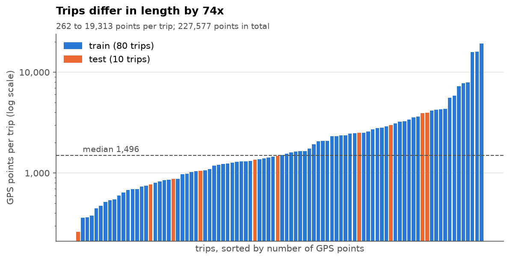

### 2. Missing values: none, but there are time gaps

* **0 NaN values** and **0 broken references** (every arc points to real nodes and every route arc exists).
* **96.7 %** of consecutive fixes are exactly **1 s** apart. 70 gaps last over a minute (23 trips).
  Two extremes: **trip 90 has a 42.5 h gap** and **trip 78 a 14.7 h gap**. Each is really two
  recordings joined together, so split tracks at long gaps.
* **Timestamps next to a gap are often wrong.** For example, "8 s for 30 m" is followed by several
  "1 s for 85 m" steps (306 km/h). The positions are fine, but the time was logged at the wrong fix.
  921 steps in 23 trips exceed 200 km/h for this reason. **Do not use raw 1-step speed as a
  feature.** Use speed averaged over a window (≈10 fixes); `trip_summary.py` shows how.
* Very few slow fixes: only 1.6 % of 10-step windows are below 15 km/h, and there are almost no
  stationary fixes. It looks like stops were filtered out before the data was released.

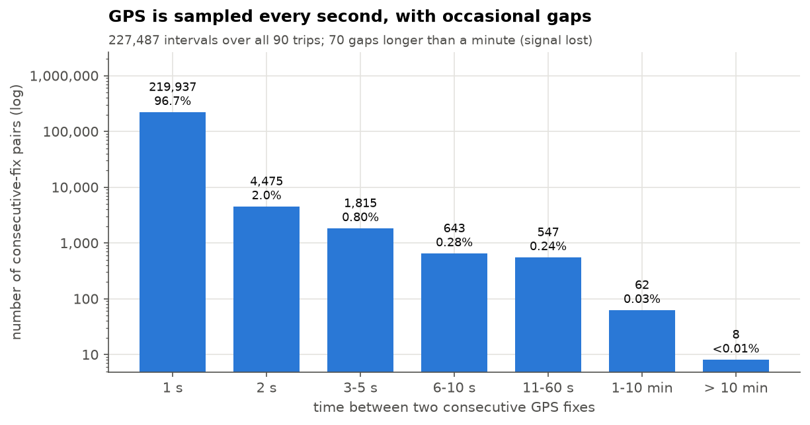

### 3. The trips are worldwide, so EPSG:27700 is the wrong projection

The trips cover **25 different UTM zones**: Europe, Russia, USA, Japan, Vietnam, the Philippines,
Brazil, Argentina, South Africa and more.
EPSG:27700 (British National Grid) is only valid for Great Britain. Used on Moscow or Vietnam, it
gives distances that are badly wrong, so every "50 m" radius would be wrong too.
**Use the trip's own UTM zone.** `geo.LocalProjection` picks it automatically:

```python
from eda.geo import LocalProjection
proj = LocalProjection(track.lon, track.lat)   # picks the right UTM zone for this trip
x, y = proj.to_metres(track.lon, track.lat)    # metres, < 0.1 % scale error
```

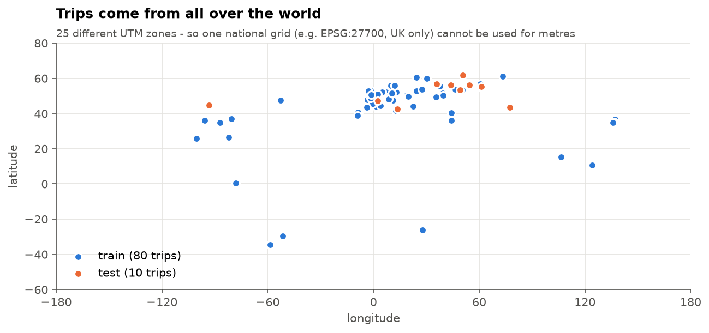

### 4. GPS noise is small, and 50 m is a good candidate radius

Distance from each fix to the nearest piece of the **true** route (in UTM metres):

| normal trips (86 of 90) | value |
|---|---:|
| median | 4.9 m |
| 95th percentile | 17.1 m |
| within 20 m | 96.5 % |
| within 30 m | 98.5 % |
| **within 50 m** | **99.3 %** |
| within 100 m | 99.96 % |

So with a 50 m radius, the true road can be missing from the candidates for only about
**0.7 % of fixes in normal trips**. This is the floor for Person B's candidate miss rate
(the 4 flagged trips below add more).

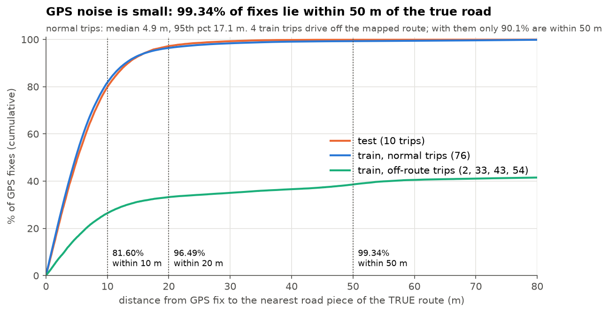

### 5. Matching is a real choice: snapping to the nearest road is not enough

* Normal trips have **6.0 road pieces within 50 m of each fix** (9.7 directed arcs, since two-way
  streets count twice). Dense town centres reach 20 or more.
* **Snapping each fix to its nearest road finds the true-route road for only 90.8 % of fixes**
  (81.9 % including the flagged trips). That is the naive baseline the model has to beat.
* Road pieces are short (median arc **25 m**), so there are about **5 fixes per route arc**.

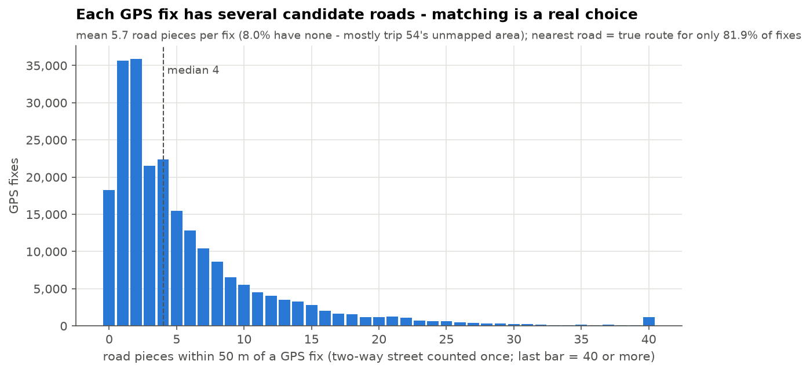
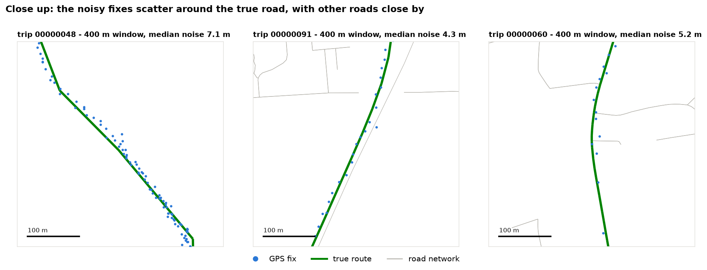

### 6. Four train trips have long stretches far from the true route (data problems)

| trip | fixes within 50 m of route | what happens (checked on the maps) |
|---|---:|---|
| 00000054 | 13 % | after 30 min, the car drives **128 km of laps for ~5 h inside a 1 km area with no mapped roads** (test track / private site). 85 % of its fixes have no road at all within 50 m |
| 00000033 | 41 % | ~3,400 fixes circle inside a small area (car park / private roads) that the route skips |
| 00000002 | 88 % | a large loop on roads that are **not in the map file**, and the route has a break there |
| 00000043 | 93 % | motorway near Utrecht: the GPS runs **50–70 m beside** the labelled carriageway for long stretches. Either the ground truth or the GPS is suspect |

All 10 test trips are clean (99.9 % within 50 m). **Recommendation for B and D:** report
the candidate miss rate and accuracy both with and without these trips, and consider removing
the off-route stretches (or these 4 trips) from training. They are flagged in the
`off_route_trip` column of `trip_summary.csv`.
Maps: [54](../results/eda/maps/trip_00000054.html), [33](../results/eda/maps/trip_00000033.html),
[2](../results/eda/maps/trip_00000002.html), [43](../results/eda/maps/trip_00000043.html).

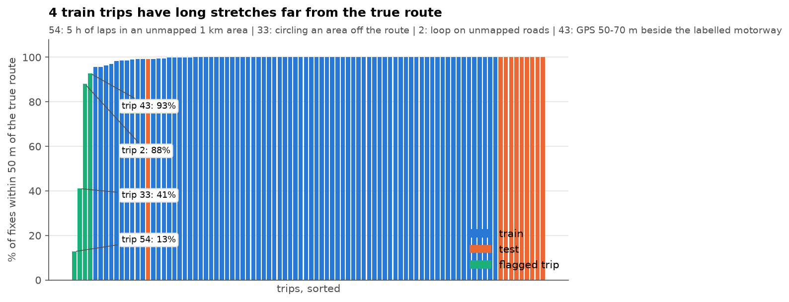

### 7. Road network quirks to handle

* Median **95 % of arcs are two-way** (u→v and v→u both present), so a candidate road appears twice.
  Decide whether candidates are arcs (direction matters) or undirected roads.
* **1,903 duplicate arcs** (same from/to pair twice) in 60 trips, plus 24 self-loop arcs (u→u).
  Deduplicate them before building candidates, or a fix could get two identical "true" labels.
* The route **repeats arcs** in 10 trips (322 repeats in total; test trip 56 alone re-drives 255 arcs), so
  "the true road for a fix" must follow time order, not just set membership.
* The route has **14 breaks** in 11 trips (consecutive route arcs that don't connect),
  usually where the map is missing a road.
* Map files range from **649 to 307,392 arcs**. Big maps (trips 13, 32, 86) need a spatial
  index (STRtree / KD-tree). A brute-force distance matrix will not fit in memory.

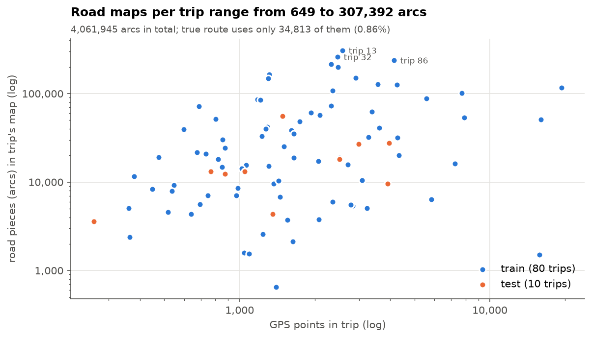

### 8. Trips at a glance

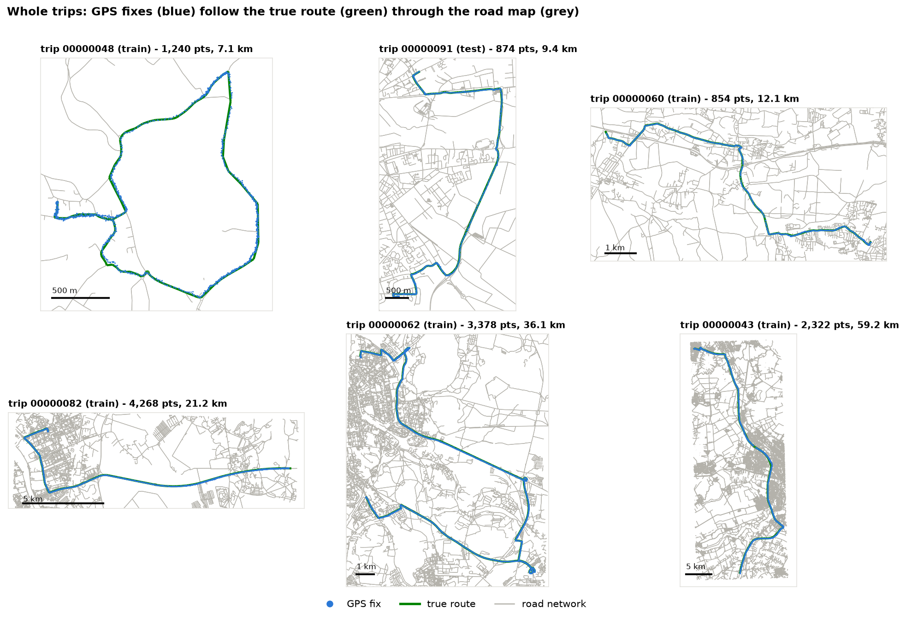
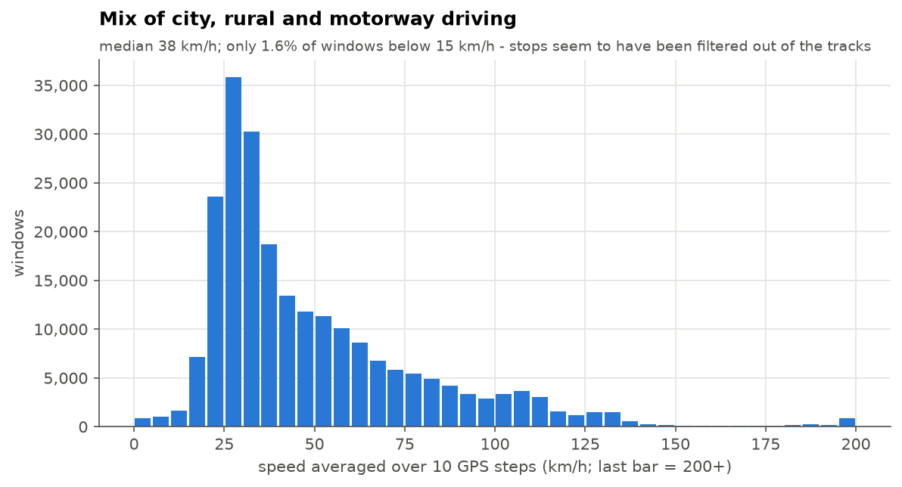

---

## Interactive maps (`results/eda/maps/`)

| Map | What it shows |
|---|---|
| `trip_00000061.html` | **showcase**: dense town centre, clean trip, 1,430 fixes |
| `trip_00000048.html`, `trip_00000060.html`, `trip_00000091.html` (test) | typical trips |
| `trip_00000054/33/02/43.html` | the four flagged data problems |
| `overview_all_trips.html` | world map, one dot per trip, click for its numbers |

Each trip map has toggleable layers: grey road network (each two-way street drawn once),
green true route, blue GPS fixes (hover for fix number, time and distance to the route), red rings for fixes
more than 20 m off the route, start and end markers, and a stats box. The basemaps need an internet connection.

## Notes for the rest of the team

* **B (candidates and labels):** use `LocalProjection`, not EPSG:27700 (finding 3). 50 m covers
  99.3 % of fixes on normal trips (finding 4). Deduplicate arcs and handle repeated route arcs
  (finding 7). Report the miss rate with and without the 4 flagged trips (finding 6).
* **Features:** use windowed speed, not 1-step speed (finding 2). Distance-to-road is the strongest
  signal, since the true road is usually within ~5 m. Split tracks at gaps over 60 s.
* **D (models):** the baseline to beat is "nearest road", which is right for 90.8 % of fixes
  on normal trips. Keep GroupKFold by trip. Trip 54 alone holds 19,313 fixes (9 % of train), so
  watch its weight.
